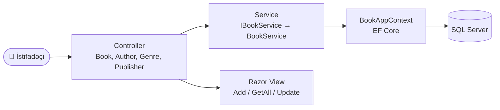
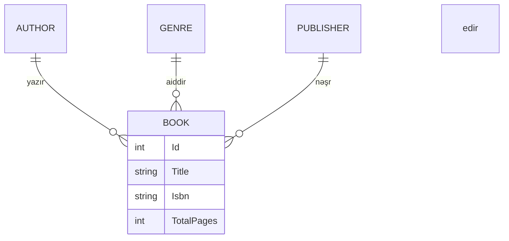

<div align="center">

# 📚 BookApp — Kitab Kitabxanası

**Kitab, müəllif, janr və nəşriyyatları idarə etmək üçün ASP.NET Core MVC veb tətbiqi**


</div>

---

## 📌 Haqqında

**BookApp** — kitab kitabxanasının məlumatlarını idarə etmək üçün server tərəfdə render olunan (Razor) **ASP.NET Core MVC** tətbiqidir.
Hər kitab bir müəllifə, janra və nəşriyyata bağlıdır; bütün bölmələr üçün tam **CRUD** əməliyyatları var.

---

## ✨ Xüsusiyyətlər

- 📖 **Kitablar** — başlıq, ISBN, səhifə sayı; müəllif, janr və nəşriyyat seçimi (dropdown)
- ✍️ **Müəlliflər**, 🏷️ **Janrlar**, 🏢 **Nəşriyyatlar** — əlavə et, siyahıya bax, yenilə, sil
- 🗄️ **EF Core Code First** — migration-larla verilənlər bazası
- 🧩 **Service qatı** — hər bölmə üçün interfeys + implementasiya (`IBookService`, `BookService`...)
- 🎨 **Razor Views + Bootstrap** interfeysi

---

## 🏗️ Arxitektura



### Verilənlər modeli



---

## 🧰 Texnologiyalar

| Sahə | Texnologiya |
|---|---|
| Platforma | .NET 8, ASP.NET Core MVC |
| Görünüş | Razor Views, Bootstrap |
| Verilənlər bazası | SQL Server, Entity Framework Core (Code First) |
| Sorğular | LINQ |

---

## 📁 Layihə strukturu

```text
BookAPI/
└── BookApp/
    ├── Controllers/        Book, Author, Genre, Publisher, Home
    ├── Models/
    │   ├── Domain/         Book, Author, Genre, Publisher
    │   └── Context/        BookAppContext
    ├── Repostories/
    │   ├── Abstracts/      IBookService, IAuthorService...
    │   └── Implementations/
    ├── Views/              Add, GetAll, Update (hər bölmə üçün)
    └── Migrations/
```

---

## 🚀 İşə salma

### Tələblər

- [.NET 8 SDK](https://dotnet.microsoft.com/download/dotnet/8.0)
- SQL Server

### Addımlar

```bash
git clone https://github.com/alesskeroov/BookAPI.git
cd BookAPI/BookApp
```

1. `appsettings.json` faylında connection string-i öz SQL Server-inə uyğunlaşdır
2. Bazanı yarat və tətbiqi işə sal:

```bash
dotnet ef database update
dotnet run
```

3. Brauzerdə konsolda göstərilən ünvanı aç

---

<div align="center">
  <sub>© 2025, Rəvan Ələsgərov</sub>
</div>
